# 02 — Story campaign

Machine data: `data/mission_catalog.json` → `story[]` (one object per stage: start effects, parameters, auto conditions, external triggers with scene/path, gating objects). Evidence: stage list = VERIFIED_ASSET (byte-exact decode of `MainScene` `MANAGERS/STORY MANAGER` `StoryManager.story_scripts`); mechanics = VERIFIED_IL (`StoryManager`, callers). Nothing here was observed at runtime.

## 1. Architecture (VERIFIED_IL)
- **One linear index.** `StoryManager.story` (int) indexes `story_scripts` (81 `StoryScript` entries, indices 0–80). Persistent key `Story` (+ `StoryBackup`). There is no branching: every advance is `story++`. "Missions" in the story sense are these stages; one stage = one objective line on the HUD (`story_txt`, localized `story_description`).
- **Load:** `StoryManager.BeginStory` reads `Story` (clamped to the count), then `InitiateStory()`.
- **Stage start = `InitiateStory()`**, which runs on every advance **and on every scene load**:
  - sets `currentStoryScript`;
  - skips the stage when `advance_if_home` and `CurrentLocation == 0`, or `advance_if_jail` and `CurrentLocation == 93`;
  - refreshes the text and the jail/associate/Hillville buttons;
  - unlocks tutorials;
  - `police_chase_on_start` → `PS.StartPoliceChase(1)`;
  - `setPrefsTo1[]` → `SPrefs.SetInt(k, 1)`;
  - `first_mission` → teleports player and main car to the serialized transforms;
  - music, `blockDrop`;
  - `deduct_debt` (once per key via `<story_key>_deduct`) → `PS.debtAm -= deduct_amount`;
  - phone call (`call_sequence`, once via `<key>_Call` when `call_only_once`);
  - `accept_job_on_start` → residence mission key `<house>_mission_<job_nr>` = 1 (and `second_job_nr`);
  - `unlock_quickBuy` → `QuickBuyEnabled` = 1;
  - rain/thunder.
- **Stage completion:** either
  - (a) an **auto flag** evaluated by `StoryManager.Update` (1–3 s polls), `InitiateStory` (home/jail skip) or a specific game method (sell, sleep, repaint, level-up, police escape); or
  - (b) an **external trigger**: an object whose serialized key (`story_name`, `storyDesc`, `storyName`) equals `currentStoryScript.story_description` calls `AdvanceStory()` (29 call sites); or
  - (c) a **direct increment** (`HeistManager.StartHeist`, intro travel menu, `Credits.Start`).
- **Free mode:** `FreeMode = 1` → `isFreeMode`, `AdvanceStory` does nothing, the stage is forced to 80; every `accept_job_on_start` job is pre-completed (`mission_prefs = 2`).
- **New game:** `MainMenu.StartNewGame` → `SPrefs.DeleteAll`, `CurrentLocation = -1` (IntroHouse). With skip-intro: `CurrentLocation = 99`, `Story = 3`.
- **Gating, not advancing:** 82 `StoryObject`s (enable/disable by stage key or index, `enable_after_story`, `disableAfterStory`), `Diamond_Marker` texts, `Shop_Button.story_name_req`, `ItemID.isStoryItem`, `Heist.requiredStory`, `PhoneButton`/`SelectResidence` story-number checks, `Pickpocket_Object.storyNr`. They read `Story`/`story` and need no sync of their own once the index is shared.

## 2. Counts
- **Story stages: 81** (VERIFIED_ASSET). 79 playable stages (0–78) plus `story73_end` (final, "Do whatever you want") plus `story73_freemode`. Stage keys skip numbers (no `story25`, `story42`, `story58`, `story59`): those were cut in the data. The count must come from the list, not the key names.
- **Objectives:** one per stage. Multi-part objectives are counters: missions 7/25, contracts 5, heavy items 10, money made 175,000, gold value 350,000, photos via residence missions.
- **Completion-path coverage:** 78/79 playable stages have a VERIFIED trigger. Stage 2 (`story3_escape`) maps by inference to the intro `story++` in `PlayerScript` (`CurrentLocation == -1` when the travel menu opens). It stays INFERRED until a runtime log confirms it.
- **Optional / branching:** none in the story list. Optional content is in separate systems ([03](03_SIDE_MISSIONS.md)), some of which story stages count (missions, contracts, heists, residences).

## 3. Phase overview (dependency graph)

```mermaid
flowchart LR
  A[0-2 Intro escape\nIntroHouse] --> B[3-9 Madison basics\nbreak-in, sell, marking, planning]
  B --> C[10-20 Hideout PC, drone,\nRobTips, heavy box, BlackBay]
  C --> D[21-28 Residence tasks,\nlockpicks, jail + associate]
  D --> E[29-35 HellNeighbour x7, agility,\n109 complete, Forestside heist]
  E --> F[36-43 pickpocket, warehouse heist,\nforklift, Hillville unlock, bracelet]
  F --> G[44-55 garage, car theft, contracts x5,\nelectronics, bombs 208]
  G --> H[56-69 repaint, cars, ATM, heavy x10,\nresidences 201/203, sleeping gas, 113]
  H --> I[70-76 hacking laptop, bank plan,\nCentral Bank heist, gold 350k]
  I --> J[77 ending trigger -> credits\n78 money 175k -> 79 final]
```

Cross-system prerequisites (VERIFIED_ASSET + IL):
- Skills: stages 5, 13, 31, 50, 53, 57 (`if_learned_skill_advance`) and stages 14/23/40/45/63/70 (item that needs a skill to buy).
- Shop items: stages 14, 23, 40, 45, 63, 70 (`advance_if_has_item`).
- Residence missions: stages 11, 21, 22, 43, 49, 54, 66, plus counters at 30 and 69.
- Residence completion: stages 32, 62, 64.
- Contracts: stage 48.
- Heists: stages 34, 38, 72.
- BlackBay sales: stages 20, 29, 35, 42, 47, 52, 75.
- Garage purchase: stage 44.
- Paint: stage 56.
- Jail: stages 26–27.
- Sleep: stages 68, 76.
- Police escape: stage 12.

World unlocks driven by stage data:
- `unlock_hillville` from stage 40 (Hillville journal/travel button).
- `unlock_associate` from stage 29 (`AssociateUnlocked` = 1).
- `unlock_quickBuy` (stages 14, 16, 18, 80).
- Debt deductions: 30k at stage 40, 10k at 43, 20k at 49, 20k at 53, 25k at 56, 25k at 60, 25k at 65, 345k at 76.
- `setPrefsTo1` at stage 32 (`house109_loot1..3`).
- Achievements at the end (`COMPLETE_STORY`, `HARDCORE_STORY`).

## 4. Checkpoints and persistence (VERIFIED_IL)
- **No mission checkpoints exist.** The story index is the only campaign progress marker. The disk write happens only through `SaveGame.SaveGameNewSystem`: travel, quicksave, autosave after leaving a running car or after a chase, pause-menu "save on the run", ending. It writes `StoryBackup` and `Story` **only when the live index is higher** (`SaveGame.cs:100–106`) — progress never decreases through a save.
- `StoryManager.SaveStory` (`Story = story`) exists. It is called only by stage start code paths (`save_story_on_start` flag; set on no stage in 1.27c data — VERIFIED_ASSET: flag absent in all 81 entries).
- `block_saving` (stages 0–3) makes `PlayerScript.CheckIfCanSave` refuse. `if_detected_respawn` (stage 2) → `StoryManager.RespawnOnDetect` teleports the player back to `first_mission_location_start` instead of a police chase (`PlayerScript.StartPoliceChase` skips the chase).
- After death/arrest: `GameManager.GotCaught` → jail travel (a save). The story index is kept, and some stages re-evaluate (`advance_if_jail` at stage 26).
- After restart or return to menu without saving: in-memory advances are lost (`SaveGame.LoseGame` is empty) and the stage repeats. Its start effects re-run, but they are idempotent through `_deduct`/`_Call` keys and `mission_prefs <= 0` checks.
- Story-related keys besides `Story`: `<key>_deduct`, `<key>_Call`, `<house>_mission_<i>`, `Item_<name>` (story items via `advance_if_item_pref`), `AssociateUnlocked`, `QuickBuyEnabled`, `FreeMode`, `StolenBigItems`, `MissionsCompleted`, `ContractsComplete`, `MoneyMade`, BuyTip `TipPref`s, `garage`, `VanBought` (via `parcel_strings_to_set`).

## 5. Multiplayer implications per trigger family
| Family (stages) | Can Player 2 trigger today? | Must run once on | Live replication | Persistence owner | Reuse |
|---|---|---|---|---|---|
| Poll flags on player counters: level-up, skill, item count, money, missions, contracts, heavy (3,5,13,14,23,30,31,40,45,48,50,53,57,61,63,69,70,78) | P2 advances **its sandbox copy only** (client story is independent today, WORLD_SYNC_AUDIT K) | host `StoryManager` | stage index + HUD text | host save `Story` | run the original poll **only on the host**, on host counters. Decision needed: whose counters count (shared vs Player 1) |
| `advance_if_item_pref` / residence complete / tips (17,19,25,32,37,39,41,46,58,62,64,71) | sandbox only | host | index | host | the keys they read must be host keys (W2 key mirror families) |
| Location skips (9,26,28,55,67,74) | sandbox only | host (on host `CurrentLocation`) | index | host | decision: which player's location counts (joint travel helps) |
| External object triggers (0,6,7,15,17,18,20,24,27,29,33,35,36,42,47,51,52,60,65,75) | P2's object fires on P2's copy | host, as a **story-advance transaction** keyed by (stage key, trigger object id) | index + the object's own effect (pickup removed, camera disabled …) | host | original `AdvanceStory` on the host after validating `currentStoryScript.story_description == key` |
| Residence missions (11,21,22,43,49,54,66) | P2 completes its sandbox copy; money excluded on client (W4.1B) | host `Mission_Item.MissionComplete1` (money, XP, key = 2, `missionsCompleted++`, story) | mission marker/object state | host | host transaction per `<house>_mission_<i>` |
| Heists (34,38,72) | P2 can start a heist travel? Travel is fleet/joint-travel managed; `StartHeist` itself not hooked | host (direct `story++` + `Select<heist>`) | index + joint travel | host | wrap `HeistManager.StartHeist` as a host transaction + existing travel |
| Sleep (68,76), repaint (56), sell (4,59), garage (44) | sandbox only; garage refused for P2 (W4.1B) | host | index | host | host-side original call |
| Police escape (12) | per-player chase today | host | index | host | needs a police authority decision ([06](06_NPC_AND_POLICE.md)) |
| Jail (26–28) | P2 cannot sensibly share jail today | host | index | host | jail travel for both players = design decision |
| Ending (77) | `ActivateEnd` fires on whichever instance | host | scene transition for both | host (`Credits.Start` writes `Story+1` + `FBPP.Save` — on the client this hits the sandbox) | host-only ending; client must follow without writing |

Rules that follow (INFERRED design, see [11](11_ARCHITECTURE_BLUEPRINT.md)):
- The story index is campaign state: the **host owns it**. A client never runs `AdvanceStory`/`story++`/`InitiateStory` effects that write keys or money. It receives the index and runs only presentation (`RefreshText`, buttons, `StoryObject` gating).
- Exactly-once effects of a stage start: debt deduction, job acceptance, `setPrefsTo1`, police chase on start, `first_mission` teleport, phone calls (presentation can run on both).
- Simultaneous completion: two proposals for the same stage key. The host applies the first one whose key equals the current stage and rejects the rest as stale.

## 6. Stage table (generated from `data/mission_catalog.json`)
Completion column: auto flags (polled or method-driven) and external trigger classes. Details (scene path, active-in-asset, flags) are in the JSON. Start effects omit cosmetic flags.

| # | Key | Objective (EN) | Completion | Start effects | Binding scenes |
|---|---|---|---|---|---|
| 0 | `story1_escape` | Check the security camera view | CheckCameras.story_name, intro story++ (INFERRED) | first_mission, block_saving, block_item_drop, block_all_buttons | IntroHouse, MadisonSt, PlayerHideout, Warehouse |
| 1 | `story2_escapeB` | Get your things from the shed, quietly | IntroMap, intro story++ (INFERRED) | block_saving, block_item_drop, block_all_buttons | IntroHouse |
| 2 | `story3_escape` | Escape through the back gate | intro story++ (INFERRED) | block_saving, block_item_drop, if_detected_respawn | IntroHouse |
| 3 | `story4_breakin` | Break into 102 and steal enough to level up | advance_if_level_up | first_mission, block_saving, block_all_buttons | Hillville, Jail, MadisonSt |
| 4 | `story5` | Drive to Joe's pawnshop and sell your loot | advance_if_sell_anything | block_all_buttons | MadisonSt |
| 5 | `story5b` | Learn 'Marking' skill | if_learned_skill_advance | unlock_tutorial, block_all_buttons |  |
| 6 | `story5c` | Go to a marked spot at 15:00 | AdvanceTrigger.storyDesc | block_all_buttons | MadisonSt |
| 7 | `story5d` | Mark the 103 tenant to learn his routine | AI.story_name | block_all_buttons | MadisonSt, MainScene |
| 8 | `story5e` | Enter planning mode (look at the marked tenant and press [planning_mode]) | advanceIfInPlanningMode | unlock_tutorial, block_all_buttons |  |
| 9 | `story6a` | Drive out of the area, and go to your hideout | advance_if_home |  |  |
| 10 | `story6` | Use the computer | Tutorial_PC | block_all_buttons | PlayerHideout |
| 11 | `story7` | Get to 102 and complete the task (smash a few things) | Mission_Item(resmission:102:1) |  | MadisonSt, MainScene |
| 12 | `story8` | Hide from the police | advance_on_police_escape | police_chase_on_start, unlock_tutorial, block_jail, block_all_buttons | MadisonSt |
| 13 | `story9` | Learn the 'Lockpicking (Level 1)' skill | if_learned_skill_advance |  |  |
| 14 | `story10` | Buy a basic lockpicking tool on your phone {take_out_phone} | advance_if_has_item | unlock_quickBuy, unlock_tutorial | MainScene |
| 15 | `story11` | Break into 103 and steal the drone [tenant is out 17-21] | Pickupable.story_name |  | MadisonSt, MainScene, PlayerHideout |
| 16 | `story12` | Go home and buy a 'Camera disable module' on Dronetech | DroneTech.storyName | unlock_quickBuy | MainScene, PlayerHideout |
| 17 | `story13` | Buy all 104 info on RobTips | Lockpick.story_name, advance_if_tips_bought | block_all_buttons | MadisonSt, MainScene, PlayerHideout |
| 18 | `story14` | Disable the 104 entrance camera with your drone | ReadNote.storyDesc, SecurityCamera.storyName | unlock_quickBuy, unlock_tutorial | MadisonSt, Warehouse |
| 19 | `story15` | Steal the cardboard box from 104 and bring it home | advance_if_item_pref | unlock_tutorial | MadisonSt, MainScene |
| 20 | `story16` | Open the cardboard box from 104 and send the contents via Blackbay | BlackBay_Object.story_name | unlock_tutorial | MainScene, PlayerHideout |
| 21 | `story17` | Complete a task at 110 (plant a package) | Mission_Item(resmission:110:0) | accept_job_on_start | MadisonSt, MainScene, PlayerHideout |
| 22 | `story18` | Complete the task at 105 (photograph kitchen) | Mission_Item(resmission:105:0) | accept_job_on_start | MadisonSt, MainScene |
| 23 | `story19` | Learn 'Lockpicking (Level 2)' and buy 3 lockpicks | advance_if_has_item |  | MadisonSt |
| 24 | `story20` | Try a test lockpick at your hideout | Lockpick.story_name |  | MainScene, PlayerHideout |
| 25 | `story21` | Buy all the info about 116 on Robtips | advance_if_tips_bought |  | MadisonSt |
| 26 | `story22` | Get caught by police and go to jail | advance_if_jail |  | MainScene |
| 27 | `story23` | Break out the associate from her jail cell | ActivateAssociateJail.storyName, Pickupable.story_name |  | Jail, MainScene, Warehouse |
| 28 | `story24` | Escape jail together (find the exit key) | advance_if_home |  | MainScene |
| 29 | `story26` | Steal a briefcase from 108 and send it via Blackbay | BlackBay_Object.story_name | unlock_associate, unlock_tutorial | MadisonSt, MainScene |
| 30 | `story27` | Complete 7 missions from HellNeighbour | complete_missions_amount | unlock_associate | MainScene |
| 31 | `story28` | Learn 'Agility (Level 1)' | if_learned_skill_advance | unlock_associate | MainScene |
| 32 | `story29` | Complete 109 residences and go home (all loot, missions) | advance_if_residence_complete | accept_job_on_start, unlock_associate, setPrefsTo1=house109_loot1,house109_loot2,house109_loot3 | MadisonSt |
| 33 | `story30` | Get to the Heist board at your hideout | AdvanceStoryTrigger.storyDesc | unlock_associate | PlayerHideout |
| 34 | `story30b` | Start the 'Forestside Resort' heist in your hideout | Heist.storyName, HeistManager | unlock_associate | MainScene, PlayerHideout |
| 35 | `story30c` | Steal diamond earrings from Forestside Resort and send them via Blackbay | BlackBay_Object.story_name | unlock_associate | MainScene, PlayerHideout |
| 36 | `story31` | Pickpocket a guy with pink hair (Madison St.) | Pickpocket_Object.story_name |  | MadisonSt, MainScene |
| 37 | `story32` | Break into 107, steal the warehouse plan and go home | advance_if_item_pref |  | MadisonSt |
| 38 | `story33` | Start the warehouse heist at your hideout | Heist.storyName, HeistManager |  | MainScene, PlayerHideout |
| 39 | `story34` | Steal the forklift from Warehouse 401 | advance_if_item_pref | unlock_tutorial | Warehouse |
| 40 | `story35` | Learn 'Lockpicking (Level 3)' and buy an automatic lockpick | advance_if_has_item | deduct_debt, unlock_hillville, debt -30000 | MainScene |
| 41 | `story36` | Steal a bracelet from a safe in 111 and go home | advance_if_item_pref | unlock_hillville |  |
| 42 | `story37` | Prepare the bracelet and sell it on Blackbay | BlackBay_Object.story_name | unlock_hillville, unlock_tutorial | MainScene |
| 43 | `story38` | Take a few photos in 106 | Mission_Item(resmission:106:0) | deduct_debt, accept_job_on_start, unlock_hillville, debt -10000 | MainScene |
| 44 | `story39` | Buy a garage at your hideout | advance_if_garage_bought | unlock_hillville | PlayerHideout |
| 45 | `story40` | Learn 'Car theft (Level 1)' and buy a car lock pick gun | advance_if_has_item | unlock_hillville | MainScene |
| 46 | `story41` | Steal the red car from 106 and drive home | advance_if_item_pref | unlock_hillville, unlock_tutorial | MadisonSt |
| 47 | `story43` | Take off the Transmission and catalytic converter and send them via BlackBay | BlackBay_Object.story_name | unlock_hillville, unlock_tutorial | MainScene, PlayerHideout |
| 48 | `story43b` | Complete 5 contracts | complete_contracts_amount | unlock_hillville |  |
| 49 | `story44` | Go to 204 and leave a note at garage 2A (unspotted) | Mission_Item(resmission:204:0) | deduct_debt, accept_job_on_start, unlock_hillville, debt -20000 | MainScene |
| 50 | `story45` | Learn 'Electronics (Level 1)' | if_learned_skill_advance | unlock_hillville |  |
| 51 | `story46` | Steal a laptop with confidential data from 207 and go home | Pickupable.story_name | unlock_hillville, unlock_tutorial | Hillville |
| 52 | `story47` | Hack the laptop at home and send it via BlackBay | BlackBay_Object.story_name | unlock_hillville | MainScene |
| 53 | `story48` | Learn 'Specialization (Level 1)' | if_learned_skill_advance | deduct_debt, unlock_hillville, debt -20000 |  |
| 54 | `story49` | Go to 208 and plant bombs in containers, unspotted (blowtorch needed) | Mission_Item(resmission:208:0) | accept_job_on_start, unlock_hillville, unlock_associate, unlock_tutorial | MainScene |
| 55 | `story50` | Escape home | advance_if_home | unlock_hillville, unlock_associate |  |
| 56 | `story51` | Repaint your car at the Car Service | on_repaint_advance_story | deduct_debt, unlock_hillville, unlock_associate, debt -25000 | Auto Shop |
| 57 | `story52` | Learn 'Car Theft (Level 2)' | if_learned_skill_advance | unlock_hillville, unlock_associate | Hillville |
| 58 | `story53` | Steal a car from 206 and take it home | advance_if_item_pref | unlock_hillville, unlock_associate | Hillville |
| 59 | `story54` | Sell 'Prospect' at Car Service | advance_if_item_sold | unlock_hillville, unlock_associate |  |
| 60 | `story55` | Buy an ATM hacking tool and hack the ATM in Madison St. | ATM_Object.story_name | deduct_debt, unlock_hillville, unlock_associate, unlock_tutorial, debt -25000 | MadisonSt |
| 61 | `story55_2` | Steal 10 heavy items | steal_heavy_items | unlock_hillville, unlock_associate |  |
| 62 | `story55_3` | Complete 201 residence (all loot, missions) | advance_if_residence_complete | unlock_hillville, unlock_associate |  |
| 63 | `story56` | Learn 'Specialization (Level 2)' and buy sleeping gas | advance_if_has_item | unlock_hillville, unlock_associate | MainScene |
| 64 | `story57` | Complete the 203 residence (all loot, missions) | advance_if_residence_complete | unlock_hillville, unlock_associate | MainScene |
| 65 | `story60` | Get to 113 and disable a camera security panel | SecurityPanel.story_name | deduct_debt, unlock_hillville, unlock_associate, debt -25000 | MadisonSt |
| 66 | `story61` | Take a few photos at 113 | Mission_Item(resmission:113:0) | accept_job_on_start, unlock_hillville, unlock_associate | MadisonSt, MainScene |
| 67 | `story62` | Get home | advance_if_home | unlock_hillville, unlock_associate |  |
| 68 | `story63` | Go to sleep | advance_if_slept | unlock_hillville, unlock_associate |  |
| 69 | `story63_2` | Complete 25 HellNeighbour missions | complete_missions_amount | unlock_hillville, unlock_associate |  |
| 70 | `story64` | Learn 'Electronics (Level 2)' and buy a hacking laptop | advance_if_has_item | unlock_hillville, unlock_associate | MainScene |
| 71 | `story65` | Steal the bank construction plan from 202 and go home | advance_if_item_pref | unlock_hillville, unlock_associate | Hillville, MainScene |
| 72 | `story66` | Start the 'Central Bank' heist | Heist.storyName, HeistManager | unlock_hillville, unlock_associate | MainScene |
| 73 | `story67` | Steal 350k$ worth of gold | display_amount_money_required | unlock_hillville, unlock_associate |  |
| 74 | `story68` | You got the gold, escape home! | advance_if_home | unlock_hillville, unlock_associate |  |
| 75 | `story69` | Send the gold bars via Blackbay | BlackBay_Object.story_name | unlock_hillville, unlock_associate | MainScene |
| 76 | `story70` | Get some sleep | advance_if_slept | deduct_debt, unlock_hillville, unlock_associate, debt -345000 | MainScene |
| 77 | `story71` | Meet your friend in a secluded place on Madison St. | ActivateEnd | unlock_hillville, unlock_associate | MadisonSt, MainScene |
| 78 | `story72_end` | Keep making money | complete_money_amount | unlock_hillville, unlock_associate, unlock_achievement, unlock_achievement_hardcore | MadisonSt, MainScene |
| 79 | `story73_end` | Do whatever you want | terminal | unlock_hillville, unlock_associate |  |
| 80 | `story73_freemode` | Free mode | terminal | unlock_hillville, unlock_associate, unlock_quickBuy |  |
